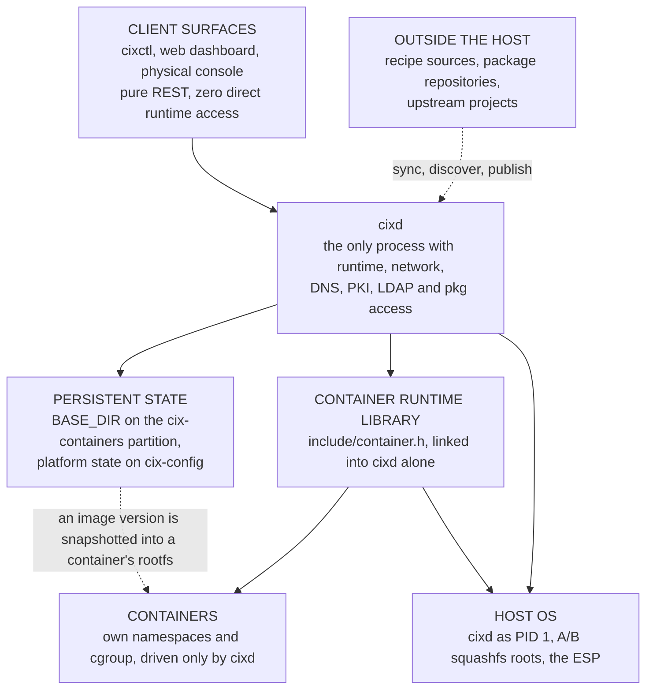
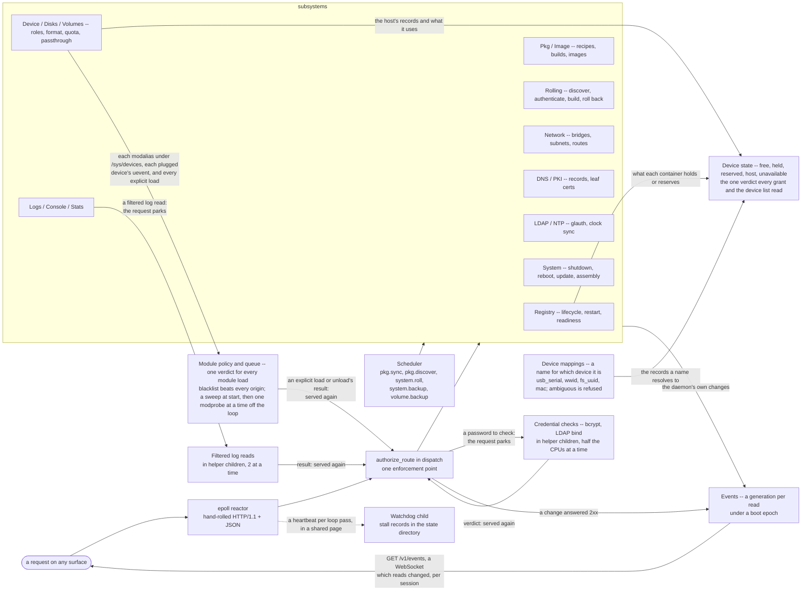
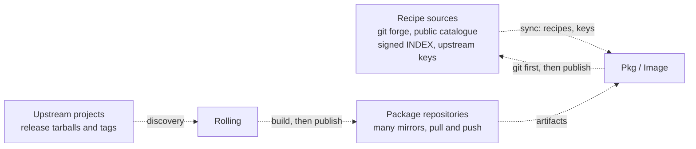
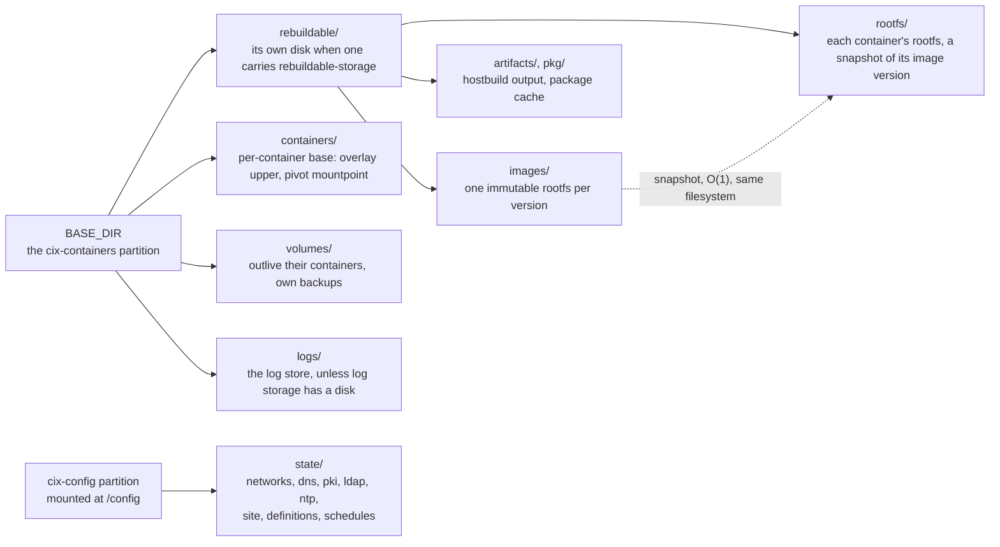
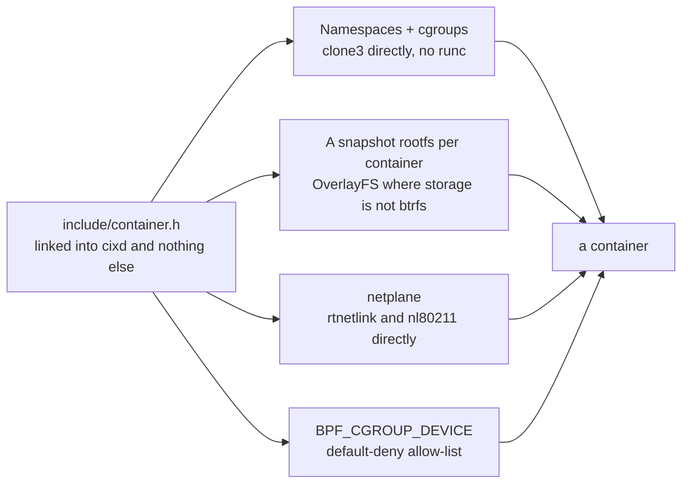
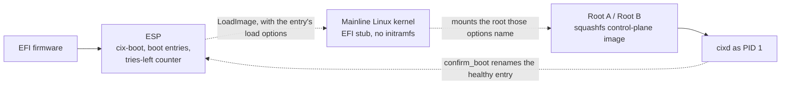

# Cix architecture

A map of the system's components and how they connect — *what exists now*, not a decision record. For why a thing is built the way it is, see [`../adr/`](../adr/); for what has shipped and how it was verified, [`../roadmap/ROADMAP.md`](../roadmap/ROADMAP.md).

**Mermaid rather than a hand-drawn SVG, deliberately** ([cix#582](https://git.home.arpa/itdlabs/cix/issues/582)). The diagram this replaced was laid out by hand, which made it expensive to change, so it was not changed: its own title said *"as of Part 92"* while ROADMAP was past 270, and it was missing most of a month's architecture. A text source diffs, reviews and greps like everything else in this tree, adding a box is adding a line, and `test_docindex` can assert that every component with a daemon source file appears here — a check that is impossible against coordinates and trivial against prose. The ADR corpus made the same argument for itself, and 335 ADRs stayed current while one SVG did not.

**Several small diagrams rather than one large one, also deliberately.** A renderer scales a chart to the page width, so one chart holding every box renders every label too small to read — measured on the first version of this page, which the owner found *"a little crazy small"*. One overview plus a diagram per layer keeps each legible, and it is what [ADR-0334](../adr/0334-the-architecture-diagram-is-generated-from-text.md)'s own clause 5 asks for: the picture carries the shape, the prose carries the detail.

## The shape

## Client surfaces

Every capability either surface offers **exists as a REST endpoint first** — the API-First Mandate ([ADR-0005](../adr/0005-api-first-mandate.md)). Neither holds namespace, cgroup, mount, rtnetlink or filesystem logic, and **no other process links `container.h`**.

- **`cixctl`** — one subcommand per endpoint, plus `console`, a real terminal over a hand-rolled WebSocket ([ADR-0043](../adr/0043-container-console-exec-websocket.md)).
- **Web dashboard** — vanilla HTML/CSS/JS, no framework and no bundler, served by cixd. `web/api.js` is generated from `openapi.yaml` by `apigen`.
- **Physical console** — video (`tty0`) and serial (`ttyS0`), a PID 1-spawned `cixctl` ([ADR-0034](../adr/0034-console-login-via-supervised-cixctl.md)).

## cixd

Single-threaded, non-blocking `epoll` reactor ([ADR-0007](../adr/0007-hand-rolled-daemon-no-external-libs.md), [ADR-0009](../adr/0009-cloexec-daemon-fds-before-clone3.md)); hand-rolled HTTP/1.1 and JSON, no external libraries. The reactor must not block — [ADR-0247](../adr/0247-the-reactor-does-not-block-and-that-is-the-defence.md) — so work it cannot afford to wait for is forked ([ADR-0278](../adr/0278-the-reactor-forks-work-it-cannot-afford-to-wait-for.md)). Checking a password is the most expensive thing a request does, so it is forked too, and the request waits for its verdict without holding the loop ([ADR-0340](../adr/0340-a-credential-is-checked-off-the-loop-and-the-request-waits-for-it.md)). A log read with a filter may have to read the whole store, so it waits the same way, through the same park ([ADR-0342](../adr/0342-a-log-read-never-walks-the-store-on-the-event-loop.md)); a read with no filter reads the store backwards and is answered at once. An explicit module load or unload is the third kind of work that parks a request: `modprobe` runs only in a helper child after start, one at a time, in the same queue as a plugged device's alias and a sweep ([ADR-0348](../adr/0348-a-device-gets-its-driver-and-one-policy-decides-every-module-load.md)).

**A watchdog child**, `cixd [watchdog]`, is forked at start and is the one thing that can record a wedged loop: the loop heartbeats through a shared page, and the child watches the clock, probes the listening port and appends what it finds to a stall record in the state directory.

**Authorisation is one point, not many, and it sits behind the reactor rather than in front of it.** The reactor accepts and parses first; every operation then carries an `x-cix-permission` the contract declares, `authorize_route()` inside `dispatch()` enforces it, and **every read needs a login** ([ADR-0317](../adr/0317-permissions-are-declared-by-the-api-contract.md)). A permission check in a handler is the parallel implementation that ADR forbids. The one trap: anything answered *before* `dispatch()` — the console, build-log and events WebSocket upgrades — must call `authorize_upgrade_route()` itself.

**Events: the box says what changed** ([ADR-0339](../adr/0339-the-dashboard-is-told-what-changed.md)). Every read the contract marks as announced has a generation counter under a random boot epoch. `dispatch()` raises the ones a successful change's `x-cix-invalidates` names, and the subsystems raise them for changes they make by themselves: a container exiting, a build changing state, a migration finishing. Each answer to such a read carries `X-Cix-Generation`, so a client knows which generation it holds, and `GET /v1/events` pushes the changes to every open stream, filtered to what each session may read.

**The scheduler** runs the platform's own periodic work: recipe sync, upstream discovery, the host roll, and system and volume backups. A fresh host starts with two schedules: `pkg.sync` every 6 hours ([ADR-0316](../adr/0316-a-fresh-host-syncs-recipes-on-a-schedule.md)), and `system.roll` in a nightly 03:00 window that hostbuilds the kernel and cix, assembles, stages and reboots ([ADR-0327](../adr/0327-the-host-follows-its-rolling-packages-in-a-nightly-window.md)). `pkg.discover` and the backups run when an operator schedules them.

## Outside the host

- **Recipe sources** — a host takes recipes from any number of them ([ADR-0324](../adr/0324-many-recipe-sources-and-many-package-repositories.md)). Write is a property of the source, not the host; one package belongs to one source; a name offered by two halts until an operator chooses. A source may be signed, and then yields only what its `INDEX` lists. Upstream keys travel in the catalogue ([ADR-0326](../adr/0326-upstream-keys-travel-in-the-signed-catalogue.md)).
- **Package repositories** — many mirrors. Their order is speed, never trust; what is accepted is decided by `artifact_sha256` and the signature.
- **Upstream projects** — where a rolling package's new versions are discovered, authenticated by a signature, a signed checksum list, a signed tag, or declared origin trust ([ADR-0323](../adr/0323-every-package-can-roll-discovery-authentication-and-a-green-build.md)). A source with none of them stays pinned.

**Git is authoritative for recipes, and a change made on a box writes back.** A recipe authored on a host is committed to its source first and only then published.

## Persistent state

Everything cixd owns lives under `BASE_DIR` on the real `cix-containers` partition ([ADR-0018](../adr/0018-containers-partition-for-base-dir-persistence.md)), except what a storage role moves to a disk of its own — and the platform's own definition of itself. That is configuration, so `STATE_DIR` is `/config/state` on the OS disk's `cix-config` partition ([cix#250](https://git.home.arpa/itdlabs/cix/issues/250)), which an A/B update does not touch.

An **image** is a set of immutable, content-addressed rootfs trees, one per version, the version being a hash of the installed package set ([ADR-0107](../adr/0107-package-image-versioning.md), [ADR-0108](../adr/0108-image-version-content-hash.md)). **An image's content comes only from its packages** ([ADR-0333](../adr/0333-an-images-content-comes-only-from-packages.md)) — the platform writes nothing into one. A container pins the version current when it was created and keeps running it.

**A container's rootfs is a btrfs snapshot of that version, kept beside the image store** ([ADR-0341](../adr/0341-a-containers-rootfs-is-a-snapshot-on-its-images-filesystem.md)), because a snapshot cannot cross a filesystem. A roll is one snapshot ioctl however many containers follow the image, and a discarded tree is set aside into a `.discard` directory on its own filesystem and deleted by a helper child, at most two at a time, off the event loop. **An image keeps a bounded history** ([ADR-0343](../adr/0343-an-image-keeps-a-bounded-history-and-a-version-leaves-it-off-the-loop.md)): every version something references plus its newest `keep` unreferenced ones, and a collected version leaves through that same queue, in a pass that never runs while a package job is in flight.

## Container runtime library

`include/container.h`, linked directly into cixd and nothing else.

- **Namespaces and cgroups**, via `clone3` directly — no runc, no libcontainer. User namespaces are the default ([ADR-0179](../adr/0179-user-namespaces-by-default-subordinate-id-allocation.md), [ADR-0207](../adr/0207-btrfs-storage-substrate-userns-by-default.md)), and a userns container sees its snapshot rootfs through an id-mapped mount rather than a per-inode chown.
- **A btrfs snapshot** of the image version is every container's rootfs ([ADR-0207](../adr/0207-btrfs-storage-substrate-userns-by-default.md), [ADR-0341](../adr/0341-a-containers-rootfs-is-a-snapshot-on-its-images-filesystem.md)). Only where rebuildable storage is not btrfs does a non-userns container fall back to **OverlayFS**, with the image version as its shared lower layer, and a userns one to a copy.
- **netplane** talks to the kernel over rtnetlink sockets directly, never shelling out to `ip`/iproute2 — and over `nl80211` for a radio, because a wireless netdev belongs to a wiphy and cannot move alone.
- **`BPF_CGROUP_DEVICE`** is a default-deny allow-list ([ADR-0017](../adr/0017-ebpf-cgroup-device-filter-for-hardware-passthrough.md)): the devices a container declared plus the standard nodes, then a deny epilogue. A container declaring no devices gets no program, and so no restriction.

**What a container is given, and how — and the two halves are different.** The *platform* stages device nodes and the standard `/dev` set at creation ([ADR-0333](../adr/0333-an-images-content-comes-only-from-packages.md)), `/etc/nsswitch.conf`, the host CA bundle, and `/etc/os-release`, re-rendered at every create. The *operator* supplies `/etc/passwd`, `/etc/group` and `/etc/resolv.conf` — as ordinary `files[]` content and `dns_servers`, where omitting the field stages nothing at all ([ADR-0143](../adr/0143-container-dns-servers-field.md)). Nothing here guesses what accounts or resolvers a container should have. Separately, a real NIC or an entire wiphy can be **moved into its network namespace** — a different mechanism from device passthrough.

**Whether a device may be given is one verdict** ([ADR-0344](../adr/0344-a-device-is-one-record-with-one-state-and-every-grant-asks-it.md)). Every device is one record in a tree — a partition under its disk, an interface under its PHY under its USB dongle — and **device state** decides each record's state from the host's own use of it and every container's grants and reservations: free, held, reserved, host or unavailable. Creating, starting, live-attaching and hotplugging all ask it, and `GET /v1/devices` reports it, so the dashboard's list and a refusal cannot disagree. A moved interface stays in that list, held, because the grant was recorded when it was made.

## Containers

Each has its own namespaces and cgroup and is driven by cixd, never by a client. `cix-init` is PID 1 inside every one: freestanding, no libc, its own `_start` and syscall trampoline ([ADR-0260](../adr/0260-a-container-declares-services-not-a-command.md)) — a container declares *services*, not a command. A container stops by a message over the control socket cixd already holds, because a signal sent to a namespace's PID 1 before it installs a handler is discarded.

**Container self-view** ([ADR-0262](../adr/0262-a-container-sees-its-own-limits.md), [ADR-0286](../adr/0286-a-container-sees-its-own-disk.md)): the runtime bind-mounts files served by `cix-procfuse` — per-cgroup `/proc/meminfo`, `cpuinfo`, `stat`, `uptime`, `loadavg`, `swaps` and `partitions`, and `/sys/devices/system/cpu/online`, `present` and `possible` — over the container's own views, so a process inside reads its own limits rather than the host's. It is one FUSE server for every container, a child cixd forks (`cixd [procfuse]`), and it also samples each container cgroup's running and uninterruptible threads every 5 s into a page shared with cixd, so `/proc/loadavg` and `GET /v1/containers/{name}/stats` serve the same load average ([ADR-0349](../adr/0349-a-containers-load-average-is-sampled-from-its-own-threads.md)).

## Host OS

**cixd runs as PID 1 directly** — no initramfs, no init system ([ADR-0016](../adr/0016-reboot-syscall-for-cixd-shutdown.md); `boot_init()` in `daemon/src/main.c` is where the absence of one is load-bearing). Mainline Linux, EFI stub boot.

**A/B root slots**: one boots, the other is the write target for the next update and is never touched live. The control-plane root is a self-built squashfs ([ADR-0014](../adr/0014-squashfs-ab-root-with-native-boot-counting.md), whose systemd-boot counting ADR-0215 later replaced with cix-boot). `mkbootroot` assembles it from the programs `include/controlplane_programs.h` lists, every one taken from the `cix-hosttools` image with no build-host fallback, and refuses to seal a root whose `DT_NEEDED` closure is incomplete ([ADR-0337](../adr/0337-the-root-is-derived-from-one-list-with-no-build-host-fallback.md)). The ESP holds the boot entries and an assessment tries-left counter; `confirm_boot()` renames the healthy slot's entry once it is serving, which is the rollback ([ADR-0031](../adr/0031-host-and-package-update-mechanism.md), [ADR-0202](../adr/0202-the-esp-is-reachable-over-rest.md), [ADR-0215](../adr/0215-our-own-efi-boot-manager.md)).

## Keeping this current

`test_docindex` asserts that every component with a daemon source file is named in this document — a string check, which is the whole reason this is text. If you add a subsystem and the gate fails, add it to whichever diagram owns that layer; if you remove one, remove it from the diagram and the prose together. The gate is what the hand-drawn SVG made impossible, and its absence is why that diagram fell 34 ADRs behind.

**The gate checks names, not arrows.** It would have caught that drift seventeen ADRs early, and it passed green on a first version of this page that drew authorisation as a gateway in front of the reactor and inverted the boot path — eight wrong edges in all. Asserting the shape is not mechanically checkable, so the practice is the safeguard: a new or rewired diagram gets its edges read against the code once, deliberately, rather than trusted because the gate is green.
